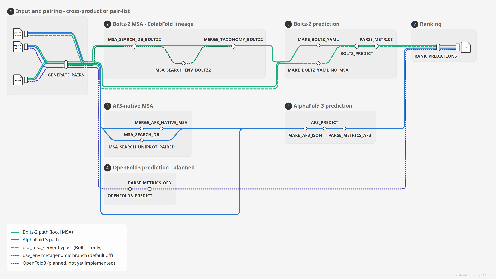

# OmegaPulldown

Structure-based protein–protein interaction screening with [Boltz-2](https://github.com/jwohlwend/boltz) and [AlphaFold 3](https://github.com/google-deepmind/alphafold3).

Analogous to [AlphaPulldown](https://github.com/KosinskiLab/AlphaPulldown) (Yu et al., *Bioinformatics* 2023) but built on a Nextflow pipeline that runs two independently trained next-generation structure predictors under a single ranking schema.



## Features

- **Bait × candidate screening** — one-vs-many or many-vs-many, from two FASTA files
- **Pair-list mode** — predict only a named set of pairs (e.g. proteomics hits) with `--pairs_tsv`
- **Dual backend** — Boltz-2 and AlphaFold 3, selectable with `--predictor boltz2 | alphafold3`
- **Post-translational modifications** — specified via a single ID-keyed TSV/CSV using CCD codes (e.g. SEP, TPO, NAG)
- **Per-predictor MSA strategies** — Boltz-2 uses ColabFold-lineage search with taxonomy tagging; AlphaFold 3 uses its own native 4-database search (UniRef90, MGnify, Small BFD for unpaired MSA; UniProt for paired MSA)
- **MSA caching** — cached alignments are reused across pairs and across runs; proteins with existing cache entries skip MSA search entirely
- **MSA server mode** — Boltz-2 can fetch MSAs from the public ColabFold API (`--use_msa_server true`, the default), avoiding local database requirements for small screens
- **Unified ranking** — ipTM, pTM, pDockQ, pLDDT, and confidence scores reported in a single TSV regardless of backend

## Pipeline stages

1. **GENERATE_PAIRS** — enumerate bait × candidate pairs (cross-product mode) or read a named pair list (pair-list mode). Pairs are collapsed on `tuple(sorted((a,b)))` to avoid predicting both A\_with\_B and B\_with\_A.
2. **MSA search** — compute MSAs per unique protein, with predictor-specific strategies:
   - *Boltz-2 local mode* (`use_msa_server=false`): MSA_SEARCH_DB_BOLTZ2 (UniRef30) → optionally MSA_SEARCH_ENV_BOLTZ2 (env/metagenomic) → MERGE_TAXONOMY_BOLTZ2 (taxonomy-ID tagging via redis + CSV output)
   - *Boltz-2 server mode* (`use_msa_server=true`, default): skipped entirely; Boltz-2 fetches MSAs from the ColabFold API at prediction time
   - *AlphaFold 3*: MSA_SEARCH_DB (UniRef90, MGnify, Small BFD independently) → MERGE_AF3_NATIVE_MSA (merge with deduplication) + MSA_SEARCH_UNIPROT_PAIRED (UniProt paired MSA)
3. **Input assembly** — MAKE_BOLTZ_YAML or MAKE_AF3_JSON per pair, with optional PTM injection
4. **Structure prediction** — BOLTZ_PREDICT or AF3_PREDICT (GPU)
5. **PARSE_METRICS / PARSE_METRICS_AF3** — extract confidence scores and compute pDockQ per pair
6. **RANK_PREDICTIONS** — aggregate all pairs into a single ranked TSV

## Quick start

```bash
# Boltz-2 with MSA server (default, simplest — no local databases needed)
nextflow run main.nf -profile slurm \
  --baits_fasta inputs/sequences/baits.fasta \
  --candidates_fasta inputs/sequences/candidates.fasta

# Boltz-2 with local MSA (no public API dependency; for large screens)
nextflow run main.nf -profile slurm \
  --baits_fasta inputs/sequences/baits.fasta \
  --candidates_fasta inputs/sequences/candidates.fasta \
  --use_msa_server false \
  --boltz2_uniref30_db /path/to/uniref30_2302_db \
  --taxonomy_rdb /path/to/taxonomy.rdb

# AlphaFold 3 (always uses local AF3-native MSA search)
nextflow run main.nf -profile slurm \
  --predictor alphafold3 \
  --use_msa_server false \
  --baits_fasta inputs/sequences/baits.fasta \
  --candidates_fasta inputs/sequences/candidates.fasta

# Pair-list mode: predict only named pairs (e.g. from proteomics)
nextflow run main.nf -profile slurm \
  --pairs_tsv ms_hits.tsv \
  --sequences_fasta all_proteins.fasta

# Reuse pre-computed alignments (skips MSA search for cached proteins)
nextflow run main.nf -profile slurm \
  --predictor alphafold3 \
  --use_msa_server false \
  --alignments_dir_af3 results/alignments_af3
```

The `-profile slurm` flag is required for GPU-accelerated prediction on HPC clusters. Without it, Nextflow runs locally and predictions will fail if no GPU is available.

## Profiles

| Profile | Description |
|---------|-------------|
| `standard` | Local execution (default) |
| `slurm` | Slurm scheduler with GPU partitions and escalate-on-retry |
| `sge` | Sun Grid Engine |
| `test` | Quick test with the bundled actin toy set (reduced sampling) |

## Input modes

### Cross-product mode (default)

Provide `--baits_fasta` and `--candidates_fasta`. Every bait is screened against every candidate. Use `--self_pairs` to include homodimer predictions when proteins appear in both files.

### Pair-list mode

Provide `--pairs_tsv` and `--sequences_fasta`. Only the pairs named in the TSV are predicted, using sequences drawn from the FASTA. The first two columns of the TSV are protein IDs (a header row is auto-detected). This mode is intended for adding structure-based ranking to an existing experimental edge list (e.g. PPIs from AP-MS or proximity labeling), rather than enumerating a full cross-product.

## Post-translational modifications

Place a file named `ptms.tsv` (or `ptms.csv`) in the same directory as your sequences FASTA, or specify it explicitly with `--ptms`. One table covers the entire run — modifications are resolved by protein ID, not by bait/candidate role:

```tsv
protein_id	position	ccd
MyProtein	84	SEP
MyProtein	142	NAG
```

Codes follow the [RCSB PDB Chemical Component Dictionary](https://www.rcsb.org/ligand).

## MSA strategies

The two predictors were trained on different MSA lineages, so OmegaPulldown maintains **separate alignment directories and search strategies** for each.

### Boltz-2

- **Server mode** (`use_msa_server=true`, default): Boltz-2 fetches MSAs from the ColabFold API at prediction time. Simplest setup — no local databases required. Recommended for small-to-moderate screens.
- **Local mode** (`use_msa_server=false`): pre-computes MSAs via mmseqs2 against UniRef30 (+ optionally an environmental database with `--use_env true`), performs taxonomy-ID tagging via a local redis instance loaded with Boltz-2's `taxonomy.rdb`, and writes per-protein CSV files. Recommended for large all-vs-all screens to avoid API rate limits and redundant remote queries.
- **Cache**: per-protein CSV files at `alignments_dir_boltz2/csv/<protein_id>.csv`.

### AlphaFold 3

- Always uses local MSA search (the ColabFold API produces Boltz-2-lineage MSAs, not AF3-native ones).
- Unpaired MSA: three independent mmseqs2 searches (UniRef90, MGnify, Small BFD) merged with exact-duplicate removal.
- Paired MSA: UniProt search, kept separate so AF3's own species-pairing code can do cross-chain matching at inference time.
- **Cache**: unpaired at `alignments_dir_af3/a3m/<protein_id>.a3m`, paired at `alignments_dir_af3/paired_a3m/<protein_id>.paired.a3m`.

## Sampling strategy

- **Boltz-2**: 5 diffusion samples per prediction (configurable via `diffusion_samples`). Boltz-2 uses conditional flow matching, which preserves structural diversity across samples. Physics-based steering potentials are enabled by default (`use_potentials=true`).
- **AlphaFold 3**: 5 seeds × 1 diffusion sample (configurable via `af3_seeds` and `af3_samples`). Within-seed samples show narrow variance in practice, so seed-to-seed variation (independent MSA subsampling and trunk computation) better captures prediction uncertainty.

## Ranking

All predictions are ranked by `protein_iptm` (mean across samples) by default. This can be changed via the `rank_by` parameter. Available metrics: `protein_iptm`, `iptm`, `pdockq`, `confidence_score`, `complex_plddt`.

The output TSV (`results/rankings_<predictor>.tsv`) reports mean and standard deviation for every metric across the samples for each pair.

## Repository structure

```
OmegaPulldown/
├── main.nf                        # Pipeline entry point and workflow logic
├── nextflow.config                # Parameters, resource labels, and profiles
├── modules/
│   ├── prepare_input.nf           # GENERATE_PAIRS, MAKE_BOLTZ_YAML(_NO_MSA)
│   ├── search_msa_boltz2.nf       # MSA_SEARCH_DB_BOLTZ2, MSA_SEARCH_ENV_BOLTZ2,
│   │                              #   MERGE_TAXONOMY_BOLTZ2
│   ├── search_msa_af3.nf          # MSA_SEARCH_DB, MERGE_AF3_NATIVE_MSA,
│   │                              #   MSA_SEARCH_UNIPROT_PAIRED
│   ├── predict_boltz2.nf          # BOLTZ_PREDICT
│   ├── predict_af3.nf             # MAKE_AF3_JSON, AF3_PREDICT
│   ├── rank.nf                    # PARSE_METRICS, RANK_PREDICTIONS
│   └── rank_af3.nf                # PARSE_METRICS_AF3
├── bin/
│   ├── generate_pairs.py          # Pair enumeration (cross-product or pair-list)
│   ├── make_boltz_yaml.py         # Boltz-2 YAML input builder with PTM support
│   ├── make_af3_json.py           # AF3 JSON builder with A3M cleaning + PTMs
│   ├── a3m_to_boltz_csv.py        # A3M → Boltz-2 CSV with taxonomy tagging
│   ├── aligned_fasta_to_a3m.py    # Aligned FASTA → A3M (UniProt paired MSA)
│   ├── merge_af3_native_msa.py    # Merge multi-DB A3Ms with deduplication
│   └── compute_pdockq.py          # pDockQ from predicted CIF structures
├── inputs/
│   └── sequences/                 # Example FASTA files (actin toy set)
├── extras/
│   └── pipeline_subway.png        # Pipeline schematic
└── results/                       # Output directory (not tracked in git)
```

## Requirements

- [Nextflow](https://www.nextflow.io/) ≥ 22.10
- [mmseqs2](https://github.com/soedinglab/MMseqs2) (for local MSA computation; not needed if using `use_msa_server=true` with Boltz-2)
- [Boltz-2](https://github.com/jwohlwend/boltz) (conda environment)
- [AlphaFold 3](https://github.com/google-deepmind/alphafold3) (Singularity container). Model weights require a [license agreement with Google DeepMind](https://github.com/google-deepmind/alphafold3/blob/main/WEIGHTS_TERMS_OF_USE.md).
- Python 3.9+ with numpy
- Redis (for Boltz-2 local MSA mode only — used to serve `taxonomy.rdb` during taxonomy tagging)

## Local setup

The shipped `nextflow.config` contains placeholder paths (e.g. `/path/to/...`) for the conda environment, mmseqs2 databases, AlphaFold 3 container, and model weights. Edit these to match your local installation before running.

Key parameters to configure:

| Parameter | Description |
|-----------|-------------|
| `conda_init` | Path to your conda executable |
| `boltz_env` | Name of the conda environment with Boltz-2 installed |
| `boltz2_uniref30_db` | mmseqs2 UniRef30 database (Boltz-2 local MSA mode) |
| `taxonomy_rdb` | Boltz-2 taxonomy.rdb file (Boltz-2 local MSA mode) |
| `af3_sif` | Singularity image for AlphaFold 3 |
| `af3_db_dir` | AlphaFold 3 genetic databases directory |
| `af3_model_dir` | AlphaFold 3 model weights directory |
| `gpu_partition` | Slurm GPU partition name |
| `gpu_partition_large` | Slurm large-GPU partition (fallback on retry) |

## References

- Yu D, Chojnowski G, Rosenthal M, Kosinski J. AlphaPulldown — a python package for protein–protein interaction screens using AlphaFold-Multimer. *Bioinformatics* 2023;39(1):btac749.
- Passaro S et al. Boltz-2: Exploring the frontiers of biomolecular structure prediction. *bioRxiv* 2025. DOI:10.1101/2025.06.14.659707.
- Abramson J et al. Accurate structure prediction of biomolecular interactions with AlphaFold 3. *Nature* 2024;630:493–500.
- Bryant P, Pozzati G, Elofsson A. Improved prediction of protein-protein interactions using AlphaFold2. *Nat Commun* 2022;13:6028.

## License

MIT
